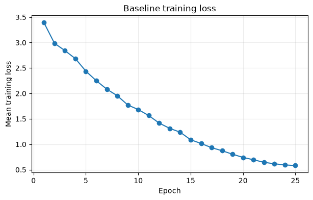
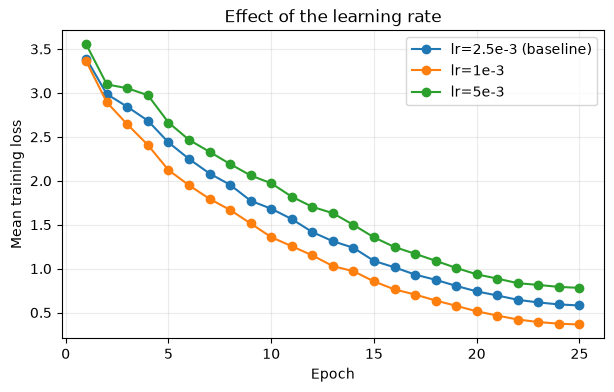
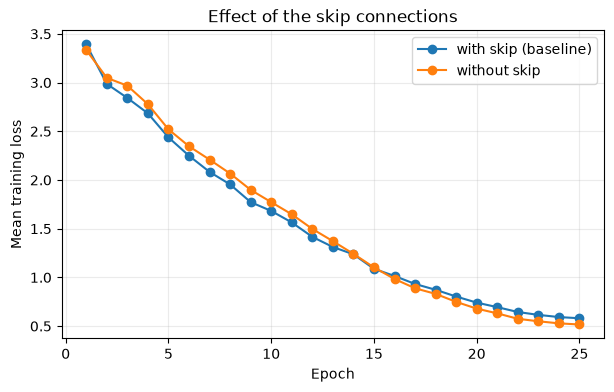
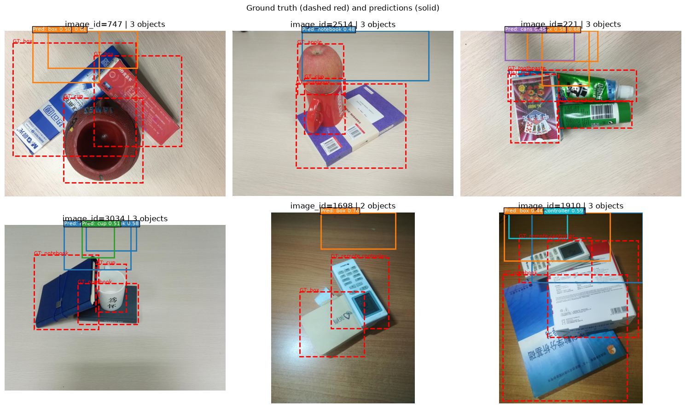

# Assignment 2 Report

Name: Hamza Amar

UCID: 30144227

Tip: To include figures in your report, put them in the `assets` folder and
link to the relative path of the images. For a Matplotlib figure, call, for
example, `plt.savefig("assets/baseline_loss.png")` before
`plt.show()`.

## AI use declaration (1 mark)

List any sources you referred to or generative-AI assistance you used, and explain how you verified the contribution. If you did not use generative AI, write: `I did not use generative AI for this assignment.`

| Source | Source contribution                                                                                                                                                                                                | How I verified it                                                                |
| ------ | ------------------------------------------------------------------------------------------------------------------------------------------------------------------------------------------------------------------ | -------------------------------------------------------------------------------- |
| Claude | I used it to generate pseudo code and also to tell me what functions I had available to me so that I could complete the code portions. It also helped me to figure out ways to improve performence on my AMD GPU. | I verified by running the cells to check if it matchs with the expected outputs. |

## Questions

**One thing to note is that the batch size for all tests was 4 as that was the limit for my AMD GPU.**

### 1. Baseline model (1 mark)

Report the validation results for the baseline model.

| Validation result   |  Value |
| ------------------- | -----: |
| Objectness loss     | 0.4735 |
| Classification loss | 0.7493 |
| Bounding-box loss   | 0.3078 |
| Total loss          | 1.8384 |
| Precision           |  0.668 |
| Recall              |  0.654 |

Include the baseline training-loss plot here and briefly describe the training behaviour.

The training loss decreases gradually until it starts to slowdown and levels at around the 21st Epoch. The first 5 Epochs had the greatest loss reductions going from about 3.4 to 2.4 while the rest of the Epochs improved the training loss gradually until it hit 0.6. The training loss (0.6) is far below the validation loss (1.84) which points to the model overfitting on the training data.

### 2. Training hyperparameter (2 marks)

State the one training hyperparameter you investigated. Compare the baseline setting with two alternatives while keeping other settings fixed where possible.

Chosen hyperparameter: peak learning rate (`lr` and `max_lr` of OneCycleLR together)

| Training setting         | Validation loss | Precision | Recall |
| ------------------------ | --------------: | --------: | -----: |
| Baseline: lr = 2.5e-3    |          1.8384 |     0.668 |  0.654 |
| Alternative 1: lr = 1e-3 |          1.9130 |     0.781 |  0.606 |
| Alternative 2: lr = 5e-3 |          1.9931 |     0.578 |  0.615 |

Plot the three training-loss curves together. Compare their shapes and validation results, explain plausible reasons for the differences, and identify which setting you would choose.

Data, seed, model, epochs and batch size were identical in all three runs. The lower learning rate (1e-3) reached the lowest training loss of 0.37 at epoch 25, the baseline ended at about 0.6, and the higher rate (5e-3) converged slowest and ended highest at about 0.8. Validation results do not follow the training loss as the training loss is a lot lower than the validation loss. The baseline has the lowest validation loss (1.84 vs 1.91 and 1.99) and the best recall (0.654). learning rate of 1e-3 has the best precision (0.781) but lower recall (0.606). learning rate of 5e-3 is worst on loss and precision (0.578). With a very high peak rate the optimizer takes large steps, so the loss descends more slowly and the model ends in a worse region. This is consistent with lr = 5e-3 having the worst class loss (0.865). With a low rate the model fits the training set faster and more tightly, but its validation loss is worse than the baseline's, which suggests mild overfitting. Its objectness loss is higher (0.60 vs 0.47), which fits its lower recall as it detects fewer objects but is more confident about the ones it keeps. I would choose the baseline learning rate of 2.5e-3 as it has the best validation loss and recall between the two other experiments.

### 3. Architecture change (2 marks)

State the one aspect of the model architecture you changed and explain why you chose it. Keep the data split and training settings the same as the baseline.

I removed the skip (residual) connections from the ResNet blocks (`use_skip=False`). I chose it because skip connections is the defining feature of a ResNet, so removing them isolates their contribution.

| Model                                       | Validation loss | Precision | Recall |
| ------------------------------------------- | --------------: | --------: | -----: |
| Baseline (with skip connections)            |          1.8384 |     0.668 |  0.654 |
| Modified architecture (no skip connections) |          2.1106 |     0.660 |  0.588 |

Include the baseline and modified-model training-loss curves. Compare the validation results and loss curves, and explain why the change may have helped or hurt performance.

Removing the skip connections hurt validation performance: total loss rose from 1.84 to 2.11, recall dropped from 0.654 to 0.588, and precision was about the same (0.660 vs 0.668). The training curves show the no-skip model started slightly slower, above the baseline for the about the first 14 epochs but then it crosses below it and ending lower (about 0.52 vs 0.6).  This shows that the no skip model fits the training data just as well or even better but generalizes worse due to the validation lose being higher. An explanation for this could be that without skips the network still trains fine because it is shallow, and it fits the training set slightly better, but the features it learns generalize worse to the validation set.. The overall gap in the training loss is miniscule so I wouldnt put to much emphasize on it being an improvement.

### 4. Model selection and final test result (1 mark)

Identify the final model and justify your choice using validation loss,
precision, and recall only. Discuss any tradeoff between precision and recall.
The test set must not be used for model selection.

Selected model: baseline (ResNet9Detector with skip connections, lr = 2.5e-3, 25 epochs)

Reason for selection: The baseline model has the lowest total validation loss of all four models (1.838 vs 1.913 for lr = 1e-3, 1.993 for lr = 5e-3 and 2.111 for no skip connections). It also has the highest recall (0.654) and the second-highest precision (0.668). lr = 1e-3 has a clearly higher precision (0.781) but a lower recall (0.606) and a higher loss. The learning rate of 1e-3 has better precision but misses more obejects that why instead I chose the baseline because it has the lowest loss and a more balanced precision and recall

| Final test result |  Value |
| ----------------- | -----: |
| Total loss        | 1.8751 |
| Precision         |  0.709 |
| Recall            |  0.663 |

### 5. Qualitative analysis (2 marks)

Test-set predictions of the selected model (dashed red: ground truth, solid: predictions after NMS, score threshold 0.40):

Describe what the detector does well and analyze errors or limitations that you observe. For example, consider missed objects, false detections, incorrect classes, poorly localized boxes, overlapping objects, or small objects. Propose at least one reasonable way to improve the detector.

The test results (loss 1.875, precision 0.709, recall 0.663) are close to the validation results, so the model generalized, and it often predicts somewhat the right class (box, notebook, cup, controller) with only a few confident boxes per image. Its limitations are that many predicted boxes sit above the object and only partly overlap the ground truth, stacked objects such as a cup on a notebook are hard to separate, some boxes have the wrong class such as image 221 where it predicted a can for a toothpaste. In other images such as 2514 the apple is missed, and the model overfits, with a training loss (0.6) far below the validation loss (1.84). To improve it, I would add data augmentation such as flips, color jitter and random crops to reduce overfitting, and use a finer output grid so overlapping objects get their own cells.

## Reflection (1 mark)

Include a sentence or two about:

- what you liked or disliked about the course so far, and
- what you found interesting, confusing, challenging, or motivating while working on this assignment.
- I really like how the assignment is structured, with the code-along portions accompanied by explanations and test cases to ensure everything I am doing is correct. The challenging part is knowing which tools/functions I need to use for the coding portions. I wish the examples showed some pseudocode or something to help guide us along.
